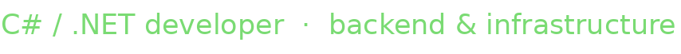

<!-- S1nflex GitHub Profile -->

<code>// a little about me</code>

<h1>hey, i'm s1nflex.</h1>

Several years into building software. Mostly backends, databases, infra and occasionally something unnecessarily low-level. I like code that's fast, clean and actually works.

<h3>tech stack <code>&lt;/&gt;</code></h3>

<b>01 / FAVORITE LANGUAGES</b> - in order, just personal taste

<table>
  <tr>
    <td align="center" width="82"> <strong>C#</strong> 01</td>
    <td align="center" width="82"> <strong>C++</strong> 01</td>
    <td align="center" width="82"> <strong>Rust</strong> 02</td>
    <td align="center" width="82"> <strong>Python</strong> 03</td>
    <td align="center" width="82"> <strong>Assembly</strong> 04</td>
    <td align="center" width="82"> <strong>C</strong> 05</td>
    <td align="center" width="82"> <strong>OCaml</strong> 06</td>
    <td align="center" width="82"> <strong>Zig</strong> 07</td>
  </tr>
</table>

and sometimes Java · JavaScript · SQL - depends on the problem.

<b>02 / BACKEND &amp; DATA</b>

<table>
  <tr>
    <td align="center" width="82"> <strong>.NET</strong></td>
    <td align="center" width="82"> <strong>ASP.NET</strong></td>
    <td align="center" width="82"> <strong>Blazor</strong></td>
    <td align="center" width="82"> <strong>PostgreSQL</strong></td>
    <td align="center" width="82"> <strong>Redis</strong></td>
    <td align="center" width="82"> <strong>Kafka</strong></td>
  </tr>
</table>

Also working with Entity Framework Core.

<b>03 / SYSTEMS &amp; INFRASTRUCTURE</b>

<table>
  <tr>
    <td align="center" width="82"> <strong>Docker</strong></td>
    <td align="center" width="82"> <strong>Linux</strong></td>
    <td align="center" width="82"> <strong>Git</strong></td>
    <td align="center" width="82"> <strong>Prometheus</strong></td>
    <td align="center" width="82"> <strong>Grafana</strong></td>
    <td align="center" width="82"> <strong>RISC-V</strong></td>
  </tr>
</table>

<h3>things i've built</h3>

<b>BinPack</b>

Bit-level serialization for .NET. More data, fewer bytes. Because apparently normal serialization wasn't enough.

<code>C#</code> · <code>.NET</code> · <code>serialization</code> · <code>bitwise stuff</code>

 writing code, chasing bugs, eating pizza. 🍕

